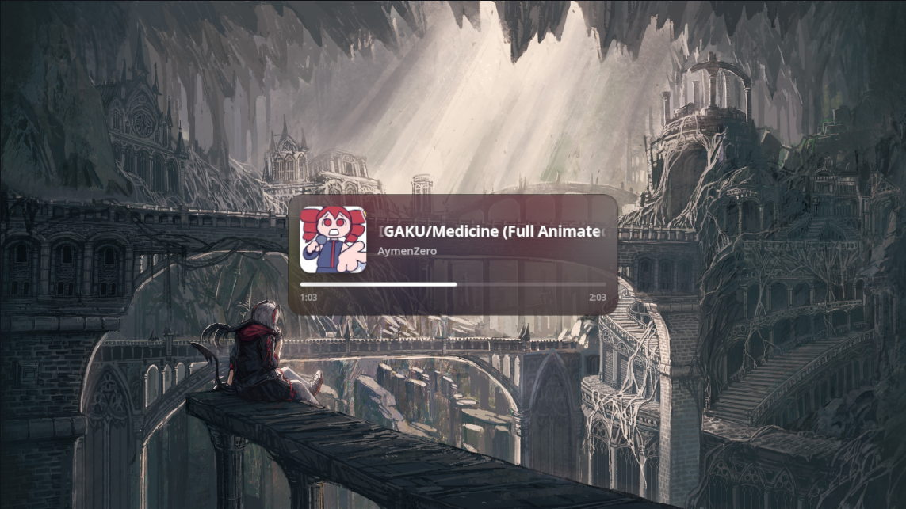

# OBS Now Playing (YouTube, YouTube Music and Spotify on Linux)

A small "now playing" card for OBS that shows the title, artist, album art and a progress bar of whatever
you're playing in YouTube, YouTube Music or Spotify (and, with one line of config, other MPRIS players such as VLC or mpv). Long titles scroll sideways, and track changes swap in place
instead of flickering.

<p align="center">
  
</p>

It has three parts:

| Part | What it does |
|------|--------------|
| `bridge/mpris-bridge.py` | Reads what your browser and native music apps report over MPRIS (using `playerctl`) and serves it as JSON on `http://127.0.0.1:5000`. |
| `userscript/now-playing.user.js` | Runs on YouTube / YouTube Music pages, reads the real title, artist and artwork, and sends them to the bridge. **Needed for YouTube in Chromium-based browsers such as Brave and Chrome**, which only report a tab title over MPRIS. Not needed for the Spotify app. |
| `widget/now-playing.html` | The card itself. Add it to OBS as a browser source. |

```
Browser ──MPRIS──▶ playerctl ─▶ bridge ◀──JSON── widget (OBS browser source)
Spotify app ─MPRIS─▶ playerctl ─▶ bridge
   └─ userscript ──POST /meta──▶ bridge        (YouTube only: artist + art + exact title)
```

Tested with Brave + YouTube Music on Linux. Spotify (desktop app and web player) is supported but has had less testing, so please open an issue if something looks off. Firefox may report artist and artwork over MPRIS by itself, in which case it might not need the userscript, but that hasn't been tested here.

## Requirements

- Linux (MPRIS is a Linux thing) with `playerctl` and Python 3
- OBS Studio (or anything that can show a browser source)
- For Spotify: the Spotify desktop app (it exposes MPRIS by itself), or the web player at open.spotify.com in your browser
- For Brave / Chrome / Chromium: a userscript manager such as [Tampermonkey](https://www.tampermonkey.net/) or [Violentmonkey](https://violentmonkey.github.io/)

## Setup

### 1. Get the files

```bash
git clone https://github.com/YOUR-USERNAME/obs-now-playing.git
cd obs-now-playing
```

### 2. Install playerctl

```bash
# Debian / Ubuntu          sudo apt install playerctl
# Arch / CachyOS           sudo pacman -S playerctl
# Fedora                   sudo dnf install playerctl
```

Play something in your browser or in the Spotify app, then run `playerctl -l`. You should see a player such as `brave.instance12345` or `spotify`.

### 3. Run the bridge

Quick test:

```bash
python3 bridge/mpris-bridge.py
```

To have it start automatically as a user service:

```bash
mkdir -p ~/.config/systemd/user
cp systemd/mpris-bridge.service ~/.config/systemd/user/
# edit the ExecStart path in that file if you cloned somewhere other than ~/obs-now-playing
systemctl --user daemon-reload
systemctl --user enable --now mpris-bridge.service
```

After changing the bridge file, apply it with `systemctl --user restart mpris-bridge.service`.

### 4. Install the userscript (Brave / Chrome / Chromium)

1. Install Tampermonkey or Violentmonkey.
2. **Allow user scripts.** Recent Chromium browsers ignore userscripts until you open `brave://extensions` (or `chrome://extensions`), click **Details** on your userscript manager, and turn on **Allow user scripts**. Reload the page after doing this.
3. Open `userscript/now-playing.user.js` on GitHub, click **Raw**, and your manager will offer to install it. Or create a new script and paste the file's contents.
4. Fully reload your YouTube / YouTube Music tab (Ctrl+Shift+R).

Firefox users may be able to skip this step (see the note at the top).

### 5. Add the widget to OBS

The bridge also serves the widget page itself, so the most reliable way is to load it over HTTP:

1. In OBS, add a **Browser** source.
2. Leave **Local file** unticked and set the URL to `http://127.0.0.1:5000/`.
3. Set the width to about `500` and the height to about `220` (the card is 460 px wide; the extra room is for its shadow).
4. Click OK, then play something. If the card doesn't appear, refresh the source (**Properties → Refresh cache of current page**).

The bridge has to be running first, and the card stays hidden until something is playing.

Alternative: tick **Local file** and choose `widget/now-playing.html` instead. This works on some setups, but the URL above avoids local-file quirks in OBS's browser.

## Settings page

Open `http://127.0.0.1:5000/config` in any browser while the bridge is running. It has a live preview and three tabs:

- **Look:** presets (Glass, Solid, Neon, Light, Compact, Minimal), colors, opacity, corner radius, width, album glow, text sizes, and toggles for album art, progress bar and times. You can set a **font** by name plus a **font URL**: either a Google Fonts link (`https://fonts.googleapis.com/css2?family=...`) or a direct `.woff2`, `.ttf` or `.otf` file.
- **When to show:** show the card the whole time something plays, or only for a few seconds each time the track changes.
- **Sources:** which websites and which desktop apps are shown. The "Playing right now" list shows every player `playerctl` can see, with a switch to enable it, so VLC, mpv, Strawberry and similar players are one click away. Only Spotify is on by default, so a video player can't end up on stream by accident.

Click **Save changes**. OBS picks the new settings up within a few seconds, with no refresh. Settings are stored in `~/.config/obs-now-playing/config.json` (change the location with `$NOW_PLAYING_CONFIG`). Only the settings page can change them, because the bridge rejects changes sent from other websites.

`config.html` has to sit in the same folder as `now-playing.html`.

## Bridge constants

The constants below are only the defaults. Anything saved on the settings page overrides them.

**Bridge** (`bridge/mpris-bridge.py`, near the top):

- `NATIVE_PLAYERS` lists desktop apps that are always shown, with no URL check. It is `("spotify",)` by default. Names are matched against `playerctl -l`, so you can add `"vlc"`, `"mpv"`, `"strawberry"`, `"rhythmbox"` and so on.
- `BROWSER_NAMES` lists which MPRIS players are treated as browsers.
- `WIDGET_FILE` is the widget page served at `http://127.0.0.1:5000/`. Leave it empty when you run the bridge from the repo, because it then finds `widget/now-playing.html` by itself. If you copy the bridge somewhere else (for example `~/.local/bin/`), set this to the full path of `now-playing.html`, or set the `NOW_PLAYING_WIDGET` environment variable.
- `ALLOWED_URL_HOSTS` is the list of sites that are shown for browser players. It is YouTube, YouTube Music, Spotify web and SoundCloud by default.
- `ALLOW_UNKNOWN_URL`:
  - `True` (default) also shows browser sessions that report no page URL. This means audio from any site may appear if the browser doesn't report its URL.
  - `False` is strict. Browser tracks are only shown if they report an allowed URL or come through the userscript, so YouTube **needs the userscript** and the widget goes blank without it. Some Chromium browsers never report a URL for Spotify web, so test it before using this.

**Widget** (`widget/now-playing.html`, top of the script): `POLL_MS`, `HIDE_AFTER_MS`, `ART_WAIT_MS` and `DEBUG` (logs track changes in the browser console). `ALLOWED_HOSTS` is an optional second URL check and is empty by default, which means the widget trusts the bridge's filtering. The look is in the `<style>` block at the top.

### Adding another player

- **A desktop app** (VLC, mpv, Strawberry, ...): run `playerctl -l` while it plays, then add part of its name to `NATIVE_PLAYERS` and restart the bridge. mpv needs an MPRIS plugin such as `mpv-mpris`.
- **A website**: add its host to `ALLOWED_URL_HOSTS`. If your browser reports poor metadata for it, also add an `@match` line to the userscript. This is untested outside YouTube.

When more than one player is active, the one that is currently playing is shown.

## Troubleshooting

- **Nothing shows, and the bridge works:** open `http://127.0.0.1:5000/now-playing` in a browser while a track plays. An empty `sessions` list means the bridge isn't seeing your browser. Run `playerctl -l` to check.
- **`http://127.0.0.1:5000/` says "now-playing.html not found next to the bridge":** the bridge can't find the widget. Set `WIDGET_FILE` (see Settings) to the full path of `now-playing.html`.
- **`http://127.0.0.1:5000/` gives a plain 404 with no text:** an old copy of the bridge is still running. Check what holds the port with `ss -ltnp | grep 5000`, stop it, and start the current one. Only run one copy at a time, because two will fight over the port.
- **Spotify doesn't show:** run `playerctl -l` while a song plays. If `spotify` isn't listed, the app isn't exposing MPRIS (check that it's running and not sandboxed from the session bus). If it is listed, make sure it matches an entry in `NATIVE_PLAYERS`, then restart the bridge.
- **"Advertisement" shows up:** that is what Spotify's free tier reports during ads.
- **Wrong title ("YouTube Music"), no artist or art:** the userscript isn't reporting. Open `http://127.0.0.1:5000/debug` and look at the last entry, `page_meta`. If it is empty:
  - check that **Allow user scripts** is on (step 4) and that the script is enabled,
  - do a full reload of the tab (Ctrl+Shift+R),
  - open the browser console on the tab and look for lines starting with `[now-playing]`.
- **See what the bridge sees:** `curl -s http://127.0.0.1:5000/debug`. When running as a service, `journalctl --user -u mpris-bridge.service -f` shows requests and art-related messages.
- **Widget is the old design after an update:** refresh the OBS browser source's cache.

## Privacy and safety

The bridge listens on `127.0.0.1` only, so it isn't reachable from other machines. It accepts userscript reports only from URLs on `ALLOWED_URL_HOSTS`. Nothing is sent to any third party, except that the widget loads album art from the source's own image servers (YouTube's or Spotify's) as usual.

## License

MIT. See [LICENSE](LICENSE).
